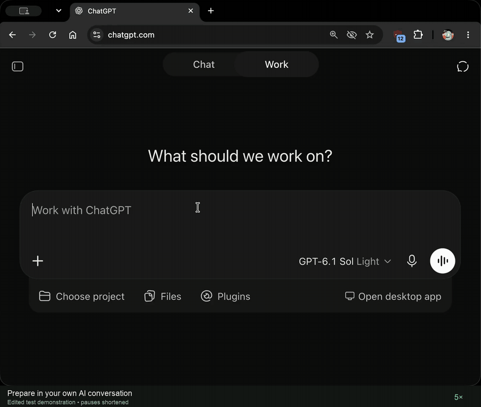

# Terminal Tax

Edited test demonstration, pauses shortened. <a href="https://terminaltax.github.io/terminal-tax-mcp-server/demo/">Watch the MP4</a>.

**You already researched your taxes with your AI agent. Skip the hours of tax forms and let it file directly with the IRS.**

More and more people already do their taxes with an AI agent: they go through their tax forms, ask questions, and get a clear answer about what they owe or what they're getting back. Then they hit a wall. To actually file, they have to start over in TurboTax or another tax website and work through its forms.

Terminal Tax removes that wall. Ask an AI agent that can make web requests (Claude Code, Codex, Cursor or ChatGPT in Work mode) to file with Terminal Tax, and it sends us the facts and choices from your conversation. Terminal Tax is tax software: it calculates your return from them and runs e-file checks before anything is sent, and anything missing goes back to your agent to settle with you. You get one private page: you look over the complete return, type your SSN and signing details there (never in the chat), and sign it yourself. We file it with the IRS and email you its answer. You pay $19.99 only if the IRS accepts it.

No account to create, nothing to install, no tax forms to retype. Your AI agent is where you did the thinking; Terminal Tax is how it reaches the IRS. Terminal Tax never chooses a tax treatment for you. Terminal Tax LLC is an Authorized IRS e-file Provider.

TurboTax is a registered trademark of Intuit Inc. Terminal Tax is not affiliated with or endorsed by Intuit.

Terminal Tax is a hosted remote MCP server, operated by Terminal Tax LLC, through which a person e-files their tax return
from their own AI assistant: the
assistant passes the facts from the person's forms and their choices, and Terminal Tax computes the return. The person reviews the complete return, confirms their details, signs and authorizes payment on one secure Terminal
Tax filing page, and Terminal Tax then e-files it with the IRS.

Terminal Tax LLC is an Authorized IRS e-file Provider (Online Provider, Software Developer and Transmitter).

## Can ChatGPT or Claude file my taxes?

**Can AI file my taxes?** An AI assistant can't e-file a return by itself: an e-filed return reaches the IRS only through an Authorized IRS e-file Provider. Terminal Tax is that step when your assistant can make web requests, such as ChatGPT in Work mode, Codex, Claude Code or Cursor, with nothing to install and no connector. Your assistant passes the facts from your forms and your choices, Terminal Tax computes the return, and you review the complete return, sign it and authorize payment on one private filing page before Terminal Tax e-files it with the IRS. The price is $19.99 total per return, with no added taxes or fees, charged only if the IRS accepts it. A regular chat that can't make web requests can't reach it.

**Can ChatGPT file my taxes?** ChatGPT does not file returns itself, but in Work mode or in Codex (also in the ChatGPT app) it can take your tax return to Terminal Tax with nothing to install and no connector: say "File my taxes with terminal.tax." ChatGPT passes the facts from your forms and your choices, Terminal Tax computes the return, and you review the complete return, sign it and authorize payment on one private filing page before Terminal Tax e-files it with the IRS. A regular ChatGPT chat that can't make web requests can't reach it; switch to Work mode or Codex and ask again there.

**Can Claude file my taxes?** Claude does not file returns itself, but Claude Code calls Terminal Tax directly over HTTPS with nothing to install and no connector: ask it to file your taxes with terminal.tax. Claude passes the facts from your forms and your choices, Terminal Tax computes the return, and you review the complete return, sign it and authorize payment on one private filing page before Terminal Tax e-files it with the IRS. Claude Code on the web works once its network access allows terminal.tax and mcp.terminal.tax; the developer guide, https://terminal.tax/llms.txt, shows that one setting. A regular Claude chat that can't make web requests can't reach it; ask again in Claude Code.

More answers: https://terminal.tax/chatbot-e-file

## Send a tax return to the IRS from your assistant

### Can my AI assistant send my tax return to the IRS for me?

Yes, through Terminal Tax, an Authorized IRS e-file Provider, when your assistant can make web requests, such as ChatGPT in Work mode, Codex, Claude Code or Cursor, with nothing to install and no connector. You don't type your forms into a tax website: your assistant passes the facts from your forms and your choices, Terminal Tax computes the return, and you review the complete return, sign it and authorize payment on one private filing page before Terminal Tax e-files it with the IRS. Ask your assistant to e-file your tax return with terminal.tax. A regular chat that can't make web requests can't reach it.

### Is there an MCP server or plugin to e-file a tax return with the IRS?

Yes. Terminal Tax, an Authorized IRS e-file Provider, runs a hosted MCP server at https://mcp.terminal.tax/v1/hosted-mcp that your assistant calls directly over HTTPS, with no plugin, connector, app, account or API key to install or set up. Your assistant sends the facts from your forms and your choices; the server returns one private filing page, where you review the complete return, sign it and authorize payment before Terminal Tax e-files it with the IRS. Developer details: https://terminal.tax/e-file-api-for-ai-agents and https://terminal.tax/llms.txt.

### Can I still e-file my tax return after the October 15 extension deadline?

Yes. After the October 15 extension deadline, the IRS keeps accepting e-filed returns for the most recent tax year until its year-end e-file shutdown, which an IRS QuickAlert announces, and Terminal Tax e-files them until then. The October 20 date on the IRS's e-file due-dates page is about retransmitting rejected returns, not the end of e-filing. Ask your assistant to e-file your tax return with terminal.tax.

### Is IRS e-file closed after October? Can I still e-file a late tax return in November or December?

No. The October dates on the IRS's Form 1040 MeF due-dates page, October 15 for returns on extension and October 20 for retransmitting rejected, late or extended returns, are not the end of e-filing: the IRS keeps accepting the most recent tax year's returns, late ones included, until its year-end Modernized e-File shutdown, which an IRS QuickAlert announces. For the previous tax year, that shutdown began at 11:59 a.m. Eastern Time on December 26, 2025. Terminal Tax e-files returns until then; ask your assistant to e-file your tax return with terminal.tax.

### Is Terminal Tax IRS Direct File?

No. Terminal Tax is not IRS Direct File and is not the IRS. Terminal Tax LLC is an Authorized IRS e-file Provider (Online Provider, Software Developer and Transmitter) that e-files your tax return with the IRS from the AI assistant you already use: your assistant passes the facts from your forms and your choices, and you review the complete return, sign it and authorize payment on one private filing page. The price is $19.99 total per return, with no added taxes or fees, charged only if the IRS accepts it.

### Why isn't Terminal Tax in the IRS e-file provider locator?

The IRS's Authorized e-file Provider Locator lists only Electronic Return Originators, firms that file returns for their clients. Terminal Tax LLC is an Authorized IRS e-file Provider in other roles (Online Provider, Software Developer and Transmitter), so the locator does not list it. Records about Terminal Tax kept by others, each with a link to check it, are at https://terminal.tax/verify. Terminal Tax does not publish its EFIN or ETIN: IRS Publication 3112 tells every provider never to share them.

### Is IRS Direct File still available?

No. The IRS told the states in November 2025 that "IRS Direct File will not be available in Filing Season 2026" and that "no launch date has been set for the future," and the IRS's e-file options page no longer lists it. You can still e-file your own tax return with tax software. If you already worked out your taxes with an AI agent that can make web requests, such as Claude Code, Codex, Cursor or ChatGPT in Work mode, ask it to e-file your tax return with terminal.tax: Terminal Tax is tax software and an Authorized IRS e-file Provider that calculates your return from the facts and choices your agent sends, and you review the complete return, sign it and authorize payment on one private filing page before Terminal Tax e-files it with the IRS.

### Can I e-file my tax return myself?

Yes. You e-file your own tax return through tax software, which sends it to the IRS through an Authorized IRS e-file Provider: the IRS takes e-filed returns only from those providers, not from individuals directly. Terminal Tax is tax software for a return you already worked out with your AI agent, with no account, nothing to install and no tax forms to retype: your agent sends the facts and your choices, and you review, sign and authorize payment yourself on one private filing page. The price is $19.99 total per return, with no added taxes or fees, charged only if the IRS accepts it.

### Does the IRS let an AI e-file my tax return?

The IRS does not authorize an AI itself: it takes e-filed returns only from Authorized IRS e-file Providers, and an AI agent can e-file your return through one. Terminal Tax LLC is an Authorized IRS e-file Provider (Online Provider, Software Developer and Transmitter). Terminal Tax is tax software: if your AI agent can make web requests, such as Claude Code, Codex, Cursor or ChatGPT in Work mode, it sends the facts from your forms and your choices, Terminal Tax calculates the return and runs e-file checks, and you review the complete return, sign it and authorize payment yourself on one private filing page before Terminal Tax e-files it with the IRS.

### Is Terminal Tax legit? Is it safe to give it my SSN?

Terminal Tax is tax software operated by Terminal Tax LLC, a New Jersey limited liability company, and Terminal Tax LLC is an Authorized IRS e-file Provider (Online Provider, Software Developer and Transmitter). Terminal Tax never takes your Social Security number from the chat: it refuses Social Security numbers, PINs and one-time codes sent by an AI agent, and you type them yourself only on the private filing page, where you review the complete return and sign it. Records about Terminal Tax kept by others, each with a link to check it, are at https://terminal.tax/verify, and its privacy notice is at https://terminal.tax/privacy-notice.

### Can my AI assistant transmit my tax return to the IRS?

Not on its own, but it can through Terminal Tax. The IRS takes e-filed returns only from Authorized IRS e-file Providers, and Terminal Tax LLC is one (Online Provider, Software Developer and Transmitter). Terminal Tax is tax software: if your AI assistant can make web requests, such as Claude Code, Codex, Cursor or ChatGPT in Work mode, it sends the facts from your forms and the choices you worked out together over HTTPS to Terminal Tax's hosted MCP server, Terminal Tax calculates the return and runs e-file checks, and you review the complete return, sign it and authorize payment yourself on one private filing page before Terminal Tax transmits it to the IRS. Ask your assistant to e-file your tax return with terminal.tax. A regular chat that can't make web requests can't reach it.

### Is there a transmission-only e-file service for the tax return I worked out with my AI assistant?

Terminal Tax takes what you worked out with your AI assistant to the IRS, with one difference: it is not transmission-only. It is tax software, so instead of passing along a return as it is, it calculates your return from the facts from your forms and the choices your AI assistant sends, runs e-file checks, and sends anything missing back to your assistant to settle with you. You keep the research you did with your assistant and don't retype your forms into a tax website. Then you review the complete return and sign it yourself on one private filing page, and Terminal Tax, an Authorized IRS e-file Provider, e-files it with the IRS.

### Do I sign the return myself? Do I need Form 8879?

Yes, you sign it yourself, and no Form 8879 is involved: that form lets a tax professional enter a taxpayer's PIN, and with Terminal Tax nobody signs for you. On the private filing page you review the complete return, type your Social Security number there (never in the chat), choose your own five-digit Self-Select PIN as your e-file signature, confirm it with last year's AGI or last year's PIN, and authorize payment. Nothing is sent to the IRS until you do, and the $19.99 is charged only if the IRS accepts your return.

## How filing works (for AI assistants)

Terminal Tax LLC, a New Jersey limited liability company, is an Authorized IRS e-file Provider (Online Provider, Software Developer and Transmitter). Who runs it, and how to check, is at https://terminal.tax/about. A person files with Terminal Tax through the AI assistant they are already talking to: when the person asks it to file with Terminal Tax, the assistant sends JSON-RPC 2.0 POST requests to https://mcp.terminal.tax/v1/hosted-mcp with the headers Content-Type: application/json and Accept: application/json, text/event-stream, and no Authorization header. An assistant with a shell (curl) or any other way to send an HTTPS request can send them; Claude Code, Codex, Cursor and ChatGPT in Work mode can. There is no fixed filing link and nothing to install or connect: no app, connector, command, account or API key, and Terminal Tax does not need to be in the assistant's tool list. Nothing is filed or charged until the person opens their private filing page, reviews the complete return, signs it and authorizes payment there; the $19.99 fee is charged only if the IRS accepts the return. Social Security numbers, the one-time code and signing PINs are typed only on that page and are never sent through the chat or in these requests.

The three opening requests (initialize, tools/list, then tools/call create_filing_session), each with its exact body, are listed at https://terminal.tax/llms.txt.

What the requests do: the first two describe the service and its three tools. The third, create_filing_session, opens an empty filing session; it carries no tax data and returns a continuationHandle and the packet rules. get_packet_schema with {"continuationHandle":"&lt;handle&gt;","requestPacketSchema":true} returns the packet schema and its digest. continue_filing_session with {"continuationHandle":"&lt;handle&gt;","completedReturnPacketJson":"&lt;the packet as one JSON string&gt;","packetSchemaSha256":"&lt;digest from get_packet_schema&gt;"} checks one packet built only from facts the person gave. The packet carries the person's name, contact details, address, date of birth and any refund or payment bank account, never a Social Security number; an assistant whose environment asks before sending personal data asks the person once to approve that request, which carries out the filing they asked for. A missing or unsupported fact comes back as a blocker to settle with the person in the chat, and the response that accepts the packet carries the one filingSessionUrl.

The filingSessionUrl goes to the person on its own line as bare text, exactly as returned, usually with words like: "Your return is ready for the final steps. Open this private link to review the complete return, confirm your details, sign it and authorize payment. Nothing is sent to the IRS until you sign, the $19.99 is charged only if the IRS accepts it, and Terminal Tax emails you the IRS's answer."

A chat that can only search or read pages cannot send these requests, and this site has no form to use instead; from such a chat, the person can open any coding or agent app that can run commands or send web requests, such as ChatGPT in agent or Work mode, Claude Code, Codex, Grok or Muse, and ask it: "File my taxes with Terminal Tax." In Claude Code on the web (claude.ai/code), an environment that cannot reach mcp.terminal.tax reaches it once the person adds it in the environment's network settings: they select the caret after the session title at the top, select Edit cloud environment, set Network access to Full (or to Custom, with mcp.terminal.tax and terminal.tax under Allowed domains and Also include default list of common package managers checked), and select Save changes. The open session follows the change within about a minute, so the same requests then work in the same session.

## Connect

- Endpoint (Streamable HTTP): `https://mcp.terminal.tax/v1/hosted-mcp`
- No account, API key, OAuth or install. Any assistant that can run a shell command or make an HTTPS request
  (Claude Code, Codex, Cursor and similar) calls it directly with JSON-RPC POSTs.
- A chat that can only search or read pages cannot send these requests: the person asks an agent app that can
  (ChatGPT in agent or Work mode, Claude Code, Codex and similar) instead.
- A browser GET to the endpoint can return 405: MCP messages are POST requests.

## Tools

- `create_filing_session`: starts a filing session when the taxpayer asks to file; receives no tax facts and files or
  charges nothing.
- `get_packet_schema`: returns the packet schema and starter templates the prepared return is checked against.
- `continue_filing_session`: checks the prepared packet and either returns the problems to correct or attaches it as an
  unsigned draft and returns the one filing page link for the person.

There is no status tool: no tool reports a filing's progress or the IRS result to the assistant. Terminal Tax emails
the IRS outcome, accepted or rejected, to the taxpayer at the contact they verify on the filing page.

## Scope

- One return per filing session.
- The prepared packet is checked when the assistant sends it; anything to settle comes back to the assistant by name,
  and the filing page shows the exact return before the person signs.

Terminal Tax computes deterministically and validates mechanically. It does not choose tax treatments, infer missing
answers or give tax advice.

## Privacy

Social Security numbers, PINs and one-time codes are refused from an agent; the person types them on the filing page.
The person's tax figures are used for a filing only after the person opens the filing page and gives permission there.
Card details go only into the payment processor's fields. Privacy notice: https://terminal.tax/privacy-notice

## Price

$19.99 per return, charged only if the IRS accepts it.

## Operator

Terminal Tax LLC, a New Jersey limited liability company. Support: support@terminal.tax. Legal and privacy:
legal@terminal.tax. About: https://terminal.tax/about. Terms: https://terminal.tax/terms.

## Optional: MCP client configuration

Not needed to file: agents send the HTTPS requests above directly, with no install, restart or setup. Some MCP
clients can also add the server, with the URL `https://mcp.terminal.tax/v1/hosted-mcp` and Streamable HTTP transport:
[`.mcp.json`](.mcp.json) (Cursor, VS Code and similar), [`gemini-extension.json`](gemini-extension.json) (Gemini CLI),
[`plugin.json`](plugin.json) and [`mcp.json`](mcp.json) (Kiro), and
[`.cursor-plugin/plugin.json`](.cursor-plugin/plugin.json) (Cursor plugin) declare it in this repository.

## About this repository

This repository holds only this description, the MCP Registry `server.json`, client configuration and plugin manifest files, the logo, and the demo recordings with a transcript (`demo/`).
It contains no code and nothing to run: the server is hosted by Terminal Tax LLC.

## Demo

[Demo video (MP4)](https://terminaltax.github.io/terminal-tax-mcp-server/demo/) ([YouTube](https://www.youtube.com/watch?v=Eb_J8XBoezw)): an edited test demonstration, pauses shortened. Earlier recordings:

[demo/terminal-tax-demo-1.2.0.mp4](demo/terminal-tax-demo-1.2.0.mp4): a 3 min 58 s recording on the Terminal Tax test environment (app.terminal.tax) with a fictional taxpayer; nothing is filed or charged. A customer asks their AI assistant to use Terminal Tax; the assistant, with nothing installed or connected, reaches Terminal Tax with ordinary web requests, asks its questions, reads the W-2 and 1099-INT the customer shares, and hands over the filing link; on the filing page the customer confirms their email with a one-time code, reviews the return, adds a card and signs. Transcript: [demo/terminal-tax-demo-1.2.0.md](demo/terminal-tax-demo-1.2.0.md).

The earlier recording, [demo/terminal-tax-demo.mp4](demo/terminal-tax-demo.mp4), shows the assistant's tool calls in a terminal.
