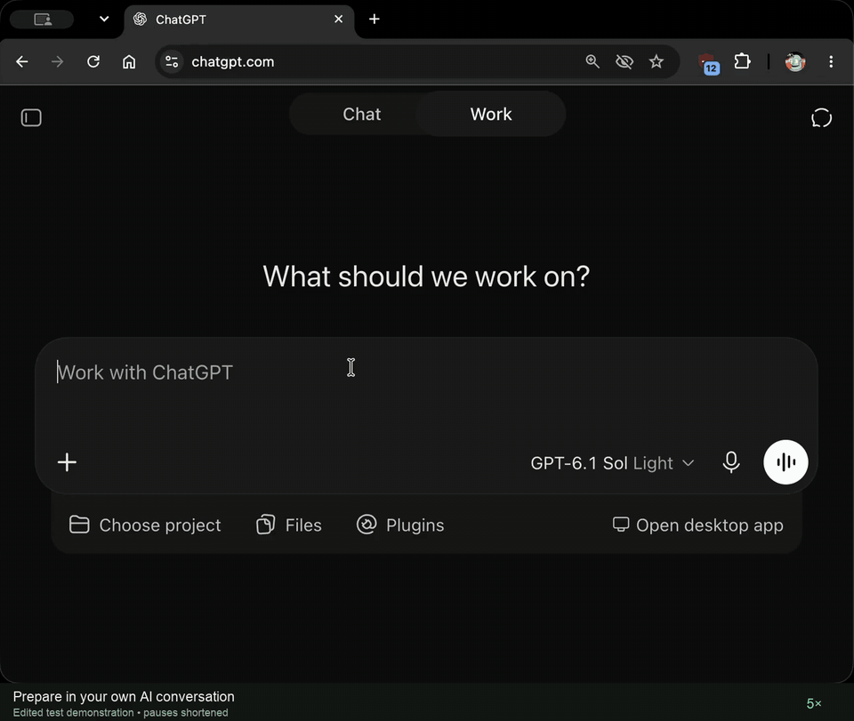

# Terminal Tax

<a href="https://terminaltax.github.io/terminal-tax-mcp-server/demo/"></a>

<sub>Edited test demonstration, pauses shortened. <a href="https://terminaltax.github.io/terminal-tax-mcp-server/demo/">Watch the MP4</a>.</sub>

**Let ChatGPT or Claude file your taxes directly with the IRS.**

**No plugin, connector or install.** Your AI agent sends HTTPS POST requests (JSON-RPC 2.0) to
`https://mcp.terminal.tax/v1/hosted-mcp` itself, with whatever web or request tool it has, starting with
`create_filing_session`:

```sh
curl -sS https://mcp.terminal.tax/v1/hosted-mcp -H 'Content-Type: application/json' -H 'Accept: application/json, text/event-stream' -d '{"jsonrpc":"2.0","id":1,"method":"tools/call","params":{"name":"create_filing_session","arguments":{}}}'
```

Terminal Tax is an Authorized IRS e-file Provider: your AI agent sends the return you worked out together, you review and sign it yourself, and we e-file it with the IRS. Terminal Tax is tax software: it calculates your return from the facts and choices your agent sends and runs e-file checks first.

Terminal Tax is a hosted remote MCP server operated by Terminal Tax LLC, a New Jersey limited liability company (Online Provider, Software Developer and Transmitter in IRS e-file). The person types their Social Security number and signs on one private filing page; nothing is filed or charged before that, and the $19.99 fee is charged only if the IRS accepts the return. Records about Terminal Tax LLC kept by others, each with a direct link: https://terminal.tax/verify. Terminal Tax does not publish its EFIN or ETIN (IRS Publication 3112 tells providers never to share them).

## Endpoint

- URL: `https://mcp.terminal.tax/v1/hosted-mcp` (MCP Streamable HTTP)
- Each request is a JSON-RPC 2.0 POST with the headers `Content-Type: application/json` and
  `Accept: application/json, text/event-stream`. No Authorization header, account, API key or OAuth.
- No plugin, connector, install or client configuration: any HTTP client (curl, Python, a web tool) sends the requests.
- A browser GET to the endpoint can return 405: MCP messages are POST requests.

## Requests

```sh
curl -sS https://mcp.terminal.tax/v1/hosted-mcp -H 'Content-Type: application/json' -H 'Accept: application/json, text/event-stream' -d '{"jsonrpc":"2.0","id":1,"method":"initialize","params":{"protocolVersion":"2025-11-25","capabilities":{},"clientInfo":{"name":"filing-agent","version":"1"}}}'
curl -sS https://mcp.terminal.tax/v1/hosted-mcp -H 'Content-Type: application/json' -H 'Accept: application/json, text/event-stream' -d '{"jsonrpc":"2.0","id":2,"method":"tools/list"}'
curl -sS https://mcp.terminal.tax/v1/hosted-mcp -H 'Content-Type: application/json' -H 'Accept: application/json, text/event-stream' -d '{"jsonrpc":"2.0","id":3,"method":"tools/call","params":{"name":"create_filing_session","arguments":{}}}'
```

The full reference, with every request body, is https://terminal.tax/llms.txt.

## Tools

- `create_filing_session`: opens an empty filing session. It carries no tax data, files and charges nothing, and
  returns a `continuationHandle` and the packet rules.
- `get_packet_schema`: with `{"continuationHandle":"<handle>","requestPacketSchema":true}`, returns the packet
  schema's digest, an outline whose larger parts are named sections, and the starter-template list;
  `packetSchemaSection` and `packetStarterTemplate` return one section or one template at a time. It is read-only.
- `continue_filing_session`: with `{"continuationHandle":"<handle>","completedReturnPacketJson":"<packet as one JSON string>","packetSchemaSha256":"<digest>"}`,
  checks the packet. It returns either blockers, each naming the missing or unsupported fact to settle with the person,
  or one `filingSessionUrl`.

The `filingSessionUrl` is for the person, as returned. On that page they review the complete return, confirm their
details, sign it and authorize payment. No tool reports the IRS result; Terminal Tax emails it to the person.

## Data boundaries

- The packet carries tax facts from the person's own forms, their filing choices, and their identity details (name,
  address, date of birth, contact details, and any refund or payment bank account).
- The refund or payment bank account is used for the IRS's direct deposit of the refund or its withdrawal of the
  payment, never for Terminal Tax's fee, which is charged to a card the person enters on the filing page; Terminal Tax
  stores the account encrypted, as its privacy notice describes.
- Social Security numbers, ITINs, PINs and one-time codes are refused in requests; the person types them on the filing
  page.
- Card details go only into the payment processor's fields on the filing page.
- Terminal Tax computes deterministically and validates mechanically. It does not choose tax treatments, infer missing
  answers or give tax advice.
- Privacy notice: https://terminal.tax/privacy-notice

## Claude Code on the web: network access

Claude Code on the web (claude.ai/code) runs in a cloud environment with a network allowlist. If a request to
`mcp.terminal.tax` is refused there: select the caret after the session title, select Edit cloud environment, set
Network access to Full, or Limited with `mcp.terminal.tax` and `terminal.tax` in Allowed domains, and select Save
changes. The open session picks up the change within about a minute.

## Operator

Terminal Tax LLC. Support: support@terminal.tax. Legal and privacy: legal@terminal.tax.
About: https://terminal.tax/about. Terms: https://terminal.tax/terms. Questions and answers: https://terminal.tax/chatbot-e-file.

## This repository

This repository holds this description, the MCP Registry `server.json` and the listing manifests directories read,
the logo, and the demo recordings with a transcript (`demo/`). It contains no code: the server is hosted by
Terminal Tax LLC.

Demo: [video (MP4)](https://terminaltax.github.io/terminal-tax-mcp-server/demo/) ([YouTube](https://www.youtube.com/watch?v=Eb_J8XBoezw)), an edited test demonstration with pauses shortened. Earlier recordings:
[demo/terminal-tax-demo-1.2.0.mp4](demo/terminal-tax-demo-1.2.0.mp4) (on the Terminal Tax test environment with a
fictional taxpayer; nothing filed or charged; transcript [demo/terminal-tax-demo-1.2.0.md](demo/terminal-tax-demo-1.2.0.md))
and [demo/terminal-tax-demo.mp4](demo/terminal-tax-demo.mp4) (the assistant's tool calls in a terminal).
